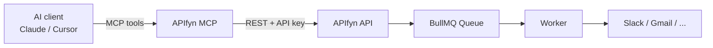

# APIfyn MCP Server

An [MCP (Model Context Protocol)](https://modelcontextprotocol.io) server for [APIfyn](https://github.com/Harshvardhan-91/APIfyn-frontend), the no-code workflow automation platform.

It lets AI assistants such as Claude, Cursor and ChatGPT build, run and monitor your APIfyn automations, so you can do it by chatting instead of using the drag-and-drop builder.

> **You:** "When someone pushes to `harsh/apifyn`, post the commit message to #deploys on Slack."
>
> **AI:** checks your connected apps → creates the workflow → "Done. 'GitHub Push → Slack #deploys' is created and paused. Want me to activate it?"

## How it works



The MCP server doesn't touch the database. It's a thin, typed layer over the APIfyn REST API, authenticated with a personal API key, so it's just another API client and gets the same per-user access checks and plan limits as the web app.

## Tools

| Tool | What it does |
|---|---|
| `list_workflows` | List workflows with their trigger, steps, active state and run count |
| `get_workflow` | Full definition, success/failure counts and the 10 most recent runs |
| `list_integrations` | Which apps (GitHub, Slack, Google, Notion) are connected |
| `create_workflow` | Create from a plain-English description (via APIfyn's AI builder) or an explicit definition. Created paused by default |
| `set_workflow_active` | Activate or pause a workflow |
| `run_workflow` | Queue a run now with a custom trigger payload; returns an `executionId` |
| `list_executions` | Recent runs, filterable by status, with cursor pagination |
| `get_execution` | One run's status, input, output and error, for checking results or debugging |
| `delete_workflow` | Permanently delete a workflow (marked destructive, so clients ask before calling it) |

Every tool carries MCP annotations (`readOnlyHint`, `destructiveHint`, ...) so clients can auto-approve safe reads and ask for confirmation before real side effects.

## 1. Get an API key

In APIfyn, go to **Settings → API keys → Create key**. Copy the `apf_...` key; it's shown only once.

A key acts as your account for workflows and runs, but it **can't** create more keys or delete your account. Revoke it from the same page at any time.

## 2. Connect your AI client

There are two ways to run the server. Both expose the same tools.

### Option A: Local (stdio)

Your AI client starts the server on your machine. Clone and build it first:

```bash
git clone https://github.com/<your-username>/apifyn-mcp.git
cd apifyn-mcp
npm install
npm run build
```

**Cursor:** add this to `~/.cursor/mcp.json` (or `.cursor/mcp.json` in a project):

```json
{
  "mcpServers": {
    "apifyn": {
      "command": "node",
      "args": ["/absolute/path/to/apifyn-mcp/dist/index.js"],
      "env": {
        "APIFYN_API_URL": "https://your-apifyn-api.example.com",
        "APIFYN_API_KEY": "apf_your_key_here"
      }
    }
  }
}
```

**Claude Desktop:** same block in `claude_desktop_config.json` (Settings → Developer → Edit Config).

**Claude Code:**

```bash
claude mcp add apifyn \
  -e APIFYN_API_URL=https://your-apifyn-api.example.com \
  -e APIFYN_API_KEY=apf_your_key_here \
  -- node /absolute/path/to/apifyn-mcp/dist/index.js
```

Once it's published to npm, `"command": "npx", "args": ["-y", "apifyn-mcp"]` will replace the clone-and-build step.

### Option B: Hosted (Streamable HTTP)

Deploy once, and every user connects with a URL plus their own key. The server stores no credentials; each request's `Authorization` header is passed through to the APIfyn API, so one deployment safely serves many users.

**Cursor:**

```json
{
  "mcpServers": {
    "apifyn": {
      "url": "https://your-mcp-host.example.com/mcp",
      "headers": { "Authorization": "Bearer apf_your_key_here" }
    }
  }
}
```

**Claude Code:**

```bash
claude mcp add --transport http apifyn https://your-mcp-host.example.com/mcp \
  --header "Authorization: Bearer apf_your_key_here"
```

## Deploying the hosted server

It's a stateless Node HTTP server, so it runs anywhere that runs a container (Render, Railway, Fly.io, a VPS):

```bash
docker build -t apifyn-mcp .
docker run -p 3333:3333 -e APIFYN_API_URL=https://your-apifyn-api.example.com apifyn-mcp
```

- `POST /mcp`: MCP endpoint (requires `Authorization: Bearer apf_...`)
- `GET /health`: health check

Because it's stateless (no MCP sessions), you can run several instances behind a load balancer with no sticky sessions.

**Rate limits:** the APIfyn API rate-limits per IP. In hosted mode all users' requests reach the API from the MCP server's IP, so raise that limit or key it by API key before opening this up to many users.

## Configuration

| Variable | Mode | Default | Description |
|---|---|---|---|
| `APIFYN_API_URL` | both | `http://localhost:5000` | Base URL of the APIfyn API (the Express server) |
| `APIFYN_API_KEY` | stdio | — | Your `apf_` key. Ignored in HTTP mode |
| `PORT` | http | `3333` | Port to listen on |

## Development

```bash
npm install
cp .env.example .env     # point at your local APIfyn API
npm run dev              # stdio mode with tsx
npm run dev:http         # HTTP mode on :3333
npm test                 # vitest: tool behaviour + end-to-end HTTP tests
npm run build && npm run inspect   # try the tools in the MCP Inspector UI
```

The tests run each tool through a real MCP client against an in-memory fake of the APIfyn API, and start the HTTP server to check that each caller's key reaches the API and nobody else's does.

### Project layout

```
src/
  index.ts    CLI entry: stdio by default, --http for hosted mode
  server.ts   builds the McpServer and its instructions
  tools.ts    the tool definitions (zod schemas + annotations)
  client.ts   typed APIfyn REST client and error mapping
  http.ts     stateless Streamable HTTP server
test/         vitest suites
```

## Requirements on the APIfyn side

This server needs an APIfyn API version that has:

- API keys (`/api/api-keys`, and `apf_` bearer tokens accepted by the auth middleware)
- `POST /api/workflow/:id/run` and `GET /api/workflow/:id/executions/:executionId`

## Ideas for what's next

- OAuth sign-in instead of pasting a key (the MCP spec supports it), which also enables Claude's and ChatGPT's remote connector UIs
- An `update_workflow` tool for chat-based edits ("add a delay before the email")
- Exposing each active workflow as its own tool, e.g. `run_notify_on_call`
